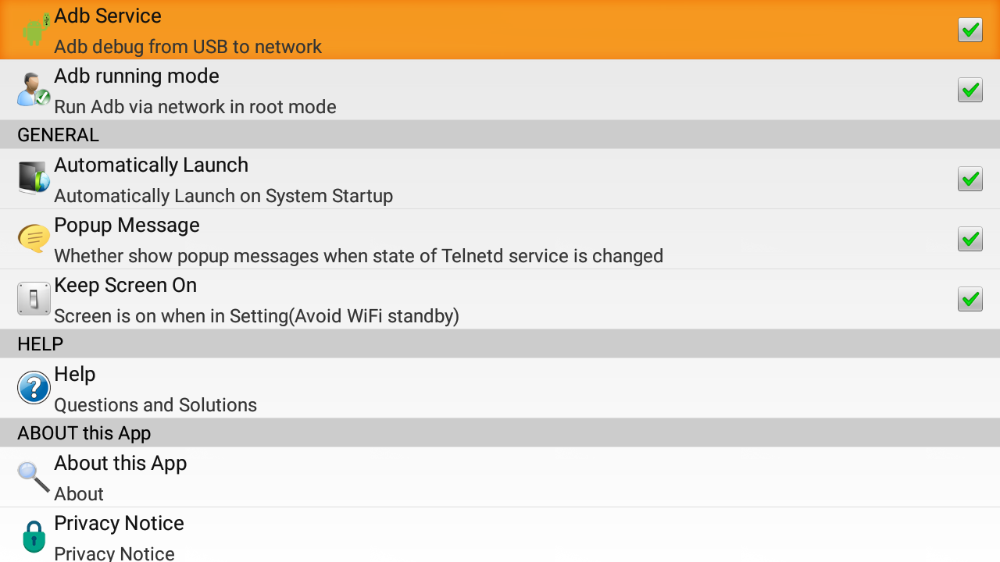
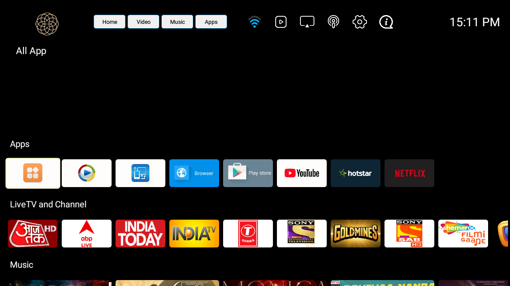
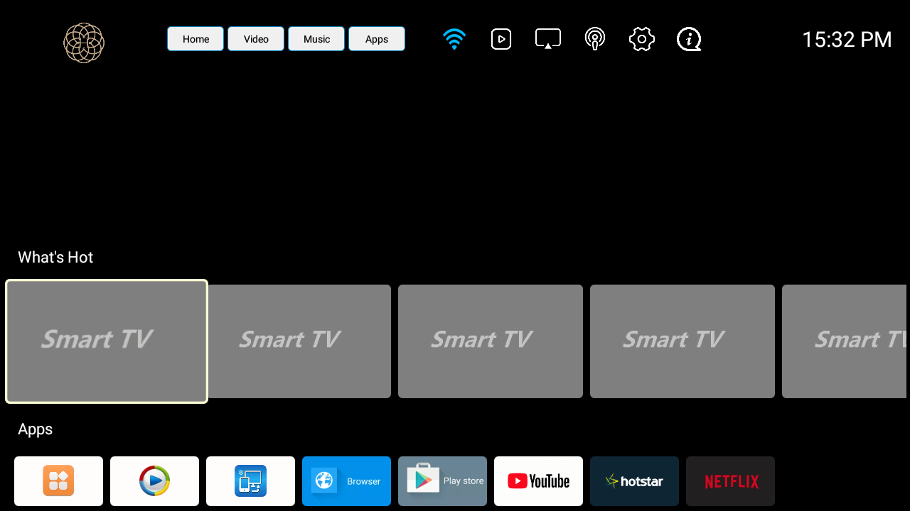
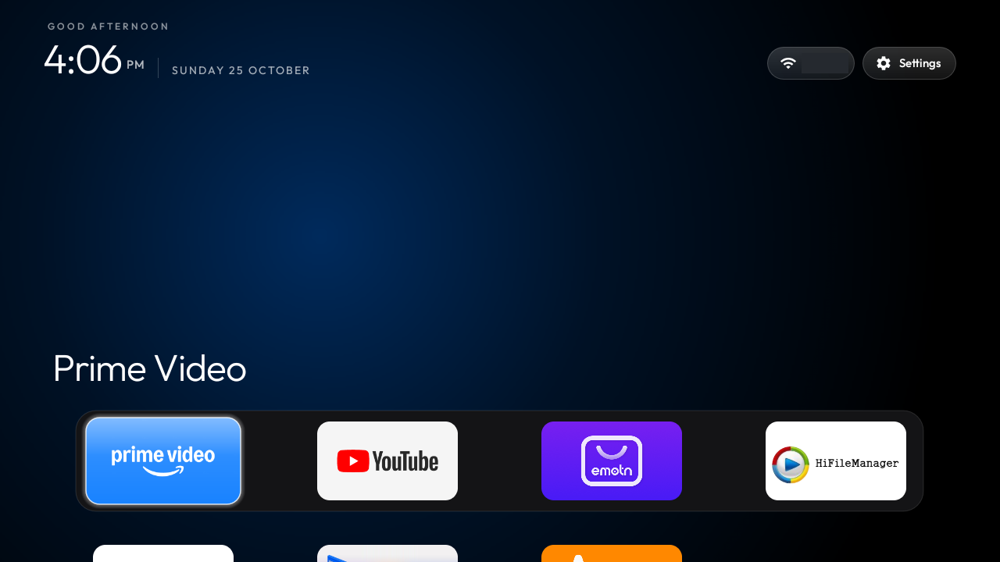
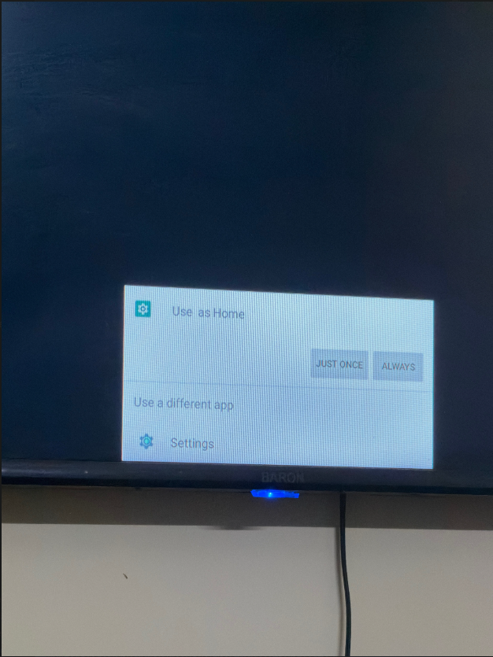

# Clean up an old Android TV over network ADB (no Developer options needed)

A step-by-step record of debloating an old Android 9 TV, turning on ad-blocking DNS, updating apps, and replacing its launcher with the [Clean Your TV](https://github.com/Gathin23/cleanyourtv) launcher, all from a Windows laptop over Wi-Fi.
Every command is listed, in the order it was used, with screenshots at the checkpoints.

> **Use at your own risk.** This was done on **one** TV. Disabling the wrong system package can stop a TV from booting. Read "Safety rules" before you change anything, and take the backup in step 3.

**Tested on:** a HiSilicon Hi3751V350/V352 board (Kitking firmware, `ro.product.name` = `Hi3751V352F_16BIT_DMO`), Android 9 (SDK 28), about 466 MB RAM, 1280x720, density 160, CPU `armeabi-v7a`, Wi-Fi only.

## Contents
1. [What you need](#1-what-you-need)
2. [Turn on network ADB](#2-turn-on-network-adb)
3. [Connect, identify the TV, back up](#3-connect-identify-the-tv-back-up)
4. [Debloat in small batches](#4-debloat-in-small-batches)
5. [Ad-blocking DNS](#5-ad-blocking-dns)
6. [Install or update apps](#6-install-or-update-apps)
7. [Replace the launcher](#7-replace-the-launcher)
8. [Fix the "Use as Home" chooser at boot](#8-fix-the-use-as-home-chooser-at-boot)
9. [Set the dock and check memory](#9-set-the-dock-and-check-memory)
10. [Close network ADB when you are done](#10-close-network-adb-when-you-are-done)
11. [Undo everything](#11-undo-everything)
12. [Screenshot guide](#12-screenshot-guide)
13. [Troubleshooting](#13-troubleshooting)
14. [Repo contents](#14-repo-contents)

## Safety rules
- Disable (`pm disable-user`), never uninstall system packages.
- Never disable: `android`, `com.android.settings`, `com.android.tv.settings`, `com.android.providers.*`, `com.android.packageinstaller`, `android.ext.*`, `com.android.bluetooth`, anything `com.hisilicon.tv*`, the Miracast package if you use it, the keyboard and remote-control services, and the app that provides your ADB (`com.waxrain.telnetd` here).
- Never open "factory", "test" or "AT" packages (here `com.android.factorytest`, `com.kitking.autofactorytest`, `com.kitking.mbasesetting`). On some boards, opening one flips a factory flag that breaks inputs and apps. Read what a package is with `dumpsys package <name>` instead of launching it.
- Disable in **small batches**, take a screenshot after each, and reboot once at the end.
- Run one `pm` command per `adb shell` call.
- Network ADB with root gives anyone on your Wi-Fi a root shell. Keep it on only while you work, and turn it off in step 10.

## 1. What you need
- A Windows laptop on the **same Wi-Fi** as the TV, with [Android platform-tools](https://developer.android.com/tools/releases/platform-tools) (`adb.exe`). Run everything from that folder in `cmd`.
- The TV's IP address (Settings > Network). Below it is written `<TV-IP>`.
- A way to run ADB on the TV. Here the TV had no Developer options, so a Telnetd app (package `com.waxrain.telnetd`) was used, which can start ADB over the network in root mode. Only use an app you trust.
- For the launcher: a free GitHub account (the APK is built by GitHub Actions, so no Android Studio is needed).

The commands use Windows `findstr`. On Linux or macOS, replace `findstr` with `grep`.

## 2. Turn on network ADB
In the Telnetd app's settings, tick **Adb Service** ("Adb debug from USB to network") and **Adb running mode** ("Run Adb via network in root mode"). Optionally **Automatically Launch** so it comes back after a reboot.



## 3. Connect, identify the TV, back up

```bat
adb connect <TV-IP>:5555
adb devices
```
If port 5555 is refused, check which port the app says it started ADB on.

Identify the TV (these decide which packages are safe to touch):
```bat
adb shell getprop ro.product.manufacturer
adb shell getprop ro.product.model
adb shell getprop ro.product.brand
adb shell getprop ro.product.name
adb shell getprop ro.build.version.release
adb shell getprop ro.build.version.sdk
adb shell getprop ro.build.fingerprint
adb shell getprop ro.adb.secure
adb shell getprop ro.product.cpu.abi
adb shell id
adb shell cat /proc/meminfo | findstr MemTotal
adb shell wm size
adb shell wm density
```
`adb shell id` showing `uid=0(root)` means the root mode worked.

**Back up before changing anything:**
```bat
mkdir tvbackup
adb shell pm list packages -f > tvbackup\packages_all.txt
adb shell pm list packages -d > tvbackup\packages_disabled_before.txt
adb shell getprop > tvbackup\getprop.txt
adb shell settings list global > tvbackup\settings_global.txt
adb shell settings list secure > tvbackup\settings_secure.txt
adb shell settings list system > tvbackup\settings_system.txt
```
Look at what is installed and what currently owns the Home key:
```bat
adb shell pm list packages -3
adb shell pm list packages -s
adb shell cmd package query-activities -a android.intent.action.MAIN -c android.intent.category.HOME
```
(`-3` = user-installed, `-s` = system. Type the long `query-activities` command as **one line**; a line break makes the TV reject it.)

**Check the TV accepts sideloaded APKs** by reinstalling an app that is already on it (VLC here):
```bat
adb shell pm path org.videolan.vlc
adb pull "/data/app/<the path printed above>/base.apk" vlc.apk
adb push vlc.apk /data/local/tmp/
adb shell pm install -r /data/local/tmp/vlc.apk
```
`Success` means sideloading works. Plain `adb install -r vlc.apk` **hung** on this TV; pushing the file and running `pm install` over the shell works. Every install script below does it that way.

## 4. Debloat in small batches
Copy the files from [`scripts/`](scripts) and [`batches/`](batches) next to `adb.exe`.

`disable_batch.bat` disables each package listed in a text file, one `pm disable-user` call per package, and logs it to `tvbackup\disabled_by_us.txt` only if the TV confirms it is disabled. What each command does inside it:
```bat
adb shell pm disable-user --user 0 <package>
adb shell pm list packages -d
```

Run one batch, then check the screen, then the next:
```bat
disable_batch.bat batches\batch1.txt
adb shell input keyevent KEYCODE_HOME
adb shell screencap -p /sdcard/s1.png
adb pull /sdcard/s1.png
```
| Batch | Packages | Why |
|---|---|---|
| 1 | `com.hisilicon.android.music`, `com.hisilicon.higallery`, `com.hisilicon.android.videoplayer`, `com.android.gallery3d`, `com.android.soundrecorder` | Preloaded media apps (VLC replaces them) |
| 2 | `com.android.browser`, `com.android.bips`, `com.android.traceur`, `com.android.emergency`, `com.android.simappdialog`, `com.android.onetimeinitializer` | Unused system extras |
| 3 | `com.hisilicon.dlna.dmp`, `com.hisilicon.dlna.dmr`, `com.kitking.upgrade` | DLNA cast duplicates and the system updater (Miracast and Bluetooth were kept) |
| 4 | `com.kitking.YouTubeLauncherV3` | The old launcher, only after the new one works (step 7 and 8) |
| 5 | `com.hisilicon.explorer` | HiSilicon's built-in file manager (VLC and File Commander stay) |

Screenshots after the debloat (the home screen must still work):




Reboot once and confirm the list survived (some firmware re-enables packages at boot):
```bat
adb reboot
adb connect <TV-IP>:5555
adb shell pm list packages -d
```
Right after this reboot the old launcher's "What's Hot" promo row showed grey placeholders (cause not confirmed: slow load right after boot, or the ad-blocking DNS from step 5):



## 5. Ad-blocking DNS
Android 9 and newer support "Private DNS". Skip this if your router already filters traffic by domain (Pi-hole, AdGuard Home, a VPN with domain lists): Private DNS bypasses it.
```bat
adb shell settings put global private_dns_specifier dns.adguard-dns.com
adb shell settings put global private_dns_mode hostname
adb shell settings get global private_dns_mode
adb shell dumpsys connectivity | findstr /i "PrivateDns"
```
The last command should show `UsePrivateDns: true` and `PrivateDnsServerName: dns.adguard-dns.com`. Test that it blocks and that normal sites still work:
```bat
adb shell ping -c 1 doubleclick.net
adb shell ping -c 1 google.com
adb shell cat /system/etc/hosts
```
Here `doubleclick.net` (an ad domain) answered `127.0.0.1` while the `hosts` file only had the two standard `localhost` lines, so the blocking came from the DNS. `google.com` resolved normally. Then play something in your streaming apps.

It does not block YouTube ads or ads inside video streams.

**Undo:** `adb shell settings put global private_dns_mode opportunistic`

## 6. Install or update apps
Download apps as **armeabi-v7a** builds (check `ro.product.cpu.abi` in step 3) from [APKMirror](https://www.apkmirror.com), with a minimum Android version of 9 or lower. APKMirror checks that apps are signed by the original developer.

Version of an installed app:
```bat
adb shell dumpsys package <package> | findstr versionName
```
**A plain `.apk`:**
```bat
install_apk.bat prime.apk
```
which runs:
```bat
adb push prime.apk /data/local/tmp/app.apk
adb shell pm install -r /data/local/tmp/app.apk
adb shell rm /data/local/tmp/app.apk
```
**A bundle (`.apkm`, an app split into several APKs):** rename it to `.zip`, extract it into a **new, empty folder**, then:
```bat
install_bundle.bat folder
```
which runs, for every `.apk` in that folder:
```bat
adb shell pm install-create -r
adb push <file>.apk /data/local/tmp/<file>.apk
adb shell pm install-write <session> <file>.apk /data/local/tmp/<file>.apk
adb shell pm install-commit <session>
adb shell rm /data/local/tmp/<file>.apk
```
Prime Video went from 6.17.0 to 6.24.12 this way, and JioHotstar and Netflix were installed the same way. Check what ended up installed:
```bat
adb shell pm list packages | findstr "netflix hotstar"
```
Notes:
- JioHotstar kept the old package name `in.startv.hotstar`, so there is no separate old Hotstar app.
- Netflix installed, but the app said it was **not compatible** with this TV. That is Netflix's own device check, not an install error. Remove it with `adb shell pm uninstall com.netflix.ninja` if it will not run.
- Errors: `INSTALL_FAILED_NO_MATCHING_ABIS` = wrong CPU build; an SDK message = version too new; `INSTALL_FAILED_UPDATE_INCOMPATIBLE` = signature mismatch (do not force it).

## 7. Replace the launcher
The launcher is [Gathin23/cleanyourtv](https://github.com/Gathin23/cleanyourtv) (MIT). It needs Android 8 or newer and has no INTERNET permission. There is no prebuilt APK, so build one with GitHub Actions:

1. On GitHub, **Fork** the repo.
2. In your fork, **Add file > Create new file**, name it `.github/workflows/build-apk.yml`, paste in [`launcher/build-apk.yml`](launcher/build-apk.yml), and commit.
3. Open the **Actions** tab, choose **Build launcher APK**, and click **Run workflow**.
4. When it finishes, download the `tvhome-apk` artifact, unzip it, and you have `app-release.apk`.

Install it (the old launcher is **not** disabled by this script, so you can always go back):
```bat
install_launcher.bat app-release.apk
```
which runs:
```bat
adb push app-release.apk /data/local/tmp/tvhome.apk
adb shell pm install -r /data/local/tmp/tvhome.apk
adb shell rm -f /data/local/tmp/tvhome.apk
adb shell pm grant com.gathin.tvhome android.permission.ACCESS_FINE_LOCATION
adb shell am start -W -a android.intent.action.MAIN -c android.intent.category.HOME -n com.gathin.tvhome/.MainActivity
adb shell cmd package set-home-activity --user 0 com.gathin.tvhome/.MainActivity
```
(`ACCESS_FINE_LOCATION` is only used to show the Wi-Fi name.) Check that the new launcher is the chosen Home:
```bat
adb shell cmd package resolve-activity --brief -a android.intent.action.MAIN -c android.intent.category.HOME
adb shell dumpsys activity activities | findstr mResumedActivity
```
The first should end with `com.gathin.tvhome/.MainActivity`. On Android 9 the second is `mResumedActivity` (`mFocusedApp` printed nothing).

Pressing Home opened the new launcher straight away, but at power-on the **old** one still appeared: at boot Android can only start Home apps marked "direct boot aware", and only the old launcher was. Once you are happy with the new launcher, disable the old one:
```bat
disable_batch.bat batches\batch4.txt
adb reboot
```


*(The Wi-Fi name in the top bar has been blanked out of this screenshot.)*

## 8. Fix the "Use as Home" chooser at boot
After disabling the old launcher, every power-on showed a **"Use as Home"** chooser. Choosing "Always" did not stick, because the choice at boot is between two Settings fallback screens of equal rank (`com.android.settings.FallbackHome` and `com.android.tv.settings.system.FallbackHome`).



Fix: switch off one of the two (a single screen inside Settings, not the app):
```bat
adb shell pm disable com.android.settings/com.android.settings.FallbackHome
adb reboot
```
After the reboot the TV went straight to the new launcher, and `adb shell dumpsys activity activities | findstr mResumedActivity` named `com.gathin.tvhome`.

If the screen stays black, reconnect over ADB and undo it:
```bat
adb shell pm enable com.android.settings/com.android.settings.FallbackHome
```
Then press every remote button (Home, Menu/Settings, Input/Source, app buttons, hold volume up to see that it still ramps).

## 9. Set the dock and check memory
Edit [`config/config.json`](config/config.json) (`dock_apps` order, `hidden_apps`, `columns`), then:
```bat
apply_theme.bat
```
which runs:
```bat
adb shell mkdir -p /sdcard/Android/data/com.gathin.tvhome/files
adb push config.json /sdcard/Android/data/com.gathin.tvhome/files/config.json
adb shell am force-stop com.gathin.tvhome
adb shell am start -a android.intent.action.MAIN -c android.intent.category.HOME
```
Missing apps are skipped and their dock slots are filled with the first grid apps. Tested here: the dock came up in exactly the order set in `config.json`. Memory check (the launcher used about 20 MB here, on a TV with about 466 MB):
```bat
adb shell dumpsys meminfo com.gathin.tvhome | findstr TOTAL
adb shell cat /proc/meminfo | findstr "MemAvailable MemFree"
```

## 10. Close network ADB when you are done
Network ADB is plaintext, and in root mode anyone on your Wi-Fi can get a shell.

1. While still connected, delete your screenshots from the TV: `adb shell rm -f /sdcard/s*.png`
2. In the Telnetd app untick **Adb Service**, **Adb running mode** and **Automatically Launch**, and **stop the telnet service** itself. If you set a password for it, change it, and never post it.
3. Restart the TV.
4. On the laptop:
```bat
adb kill-server
adb connect <TV-IP>:5555
```
You want "actively refused" (error 10061). A timeout (10060) does not prove it is closed; wake the TV and try again.

## 11. Undo everything
Needs network ADB on again (tick the boxes in the Telnetd app, then `adb connect <TV-IP>:5555`).

Back to the old launcher:
```bat
adb shell pm enable com.kitking.YouTubeLauncherV3
adb shell pm enable com.android.settings/com.android.settings.FallbackHome
adb shell cmd package set-home-activity --user 0 com.kitking.YouTubeLauncherV3/com.kitking.YouTubeLauncherV3.MainActivity
adb reboot
```
Re-enable every package the scripts disabled (from `tvbackup\disabled_by_us.txt`):
```bat
restore.bat
adb reboot
```
One package: `adb shell pm enable <package>`. Remove the new launcher (after switching Home back): `adb shell pm uninstall com.gathin.tvhome`. Turn ad-blocking off: `adb shell settings put global private_dns_mode opportunistic`.

## 12. Screenshot guide
Take a screenshot of the TV after every change, and look at it before moving on.

```bat
adb shell screencap -p /sdcard/s1.png
adb pull /sdcard/s1.png
adb shell rm /sdcard/s1.png
```
- Name them in order (`01-...png`, `02-...png`) and put them in [`screenshots/`](screenshots). A README image link such as `` makes GitHub show the picture on the repo's front page; use relative paths and no spaces in file names.
- Live TV, HDMI inputs and some streaming apps (Netflix) can come out as an empty 0-byte file. That is the TV, not a failed change. Check what is on screen with `adb shell dumpsys activity activities | findstr mResumedActivity` instead.
- Screens that appear before ADB is running (such as the boot chooser) cannot be captured with `screencap`; use a phone photo, as for that one.
- Before publishing, look at each image for things you would not post: your Wi-Fi name (blanked in 06), the TV's brand or model on a bezel, serial numbers, account names.

| Checkpoint | When to take it | File here |
|---|---|---|
| Network ADB switched on | Step 2 | `01-telnetd-adb-settings.png` |
| Home still works after the first batch | Step 4 | `02-old-launcher-after-first-batch.png` |
| Home still works after all debloat batches | Step 4 | `03-old-launcher-after-all-debloat-batches.png` |
| Home after a reboot with ad-blocking DNS | Step 4 and 5 | `04-old-launcher-after-reboot-promo-row-blank.png` |
| Boot chooser problem (photo with a phone) | Step 8 | `05-use-as-home-chooser-at-boot.png` |
| New launcher running | Step 7 and 9 | `06-new-launcher-home.png` |

## 13. Troubleshooting
Problems hit during this run, and what fixed them:
- **A pasted command ran only partly**, and the rest was run as a separate command (`'android.intent.category.HOME' is not recognized...`). The long `cmd package ... -c android.intent.category.HOME` commands must be **one line**. Paste into Notepad first.
- **`adb pull` said "No such file"**: the path from `pm path` was pasted twice or with `package:` in front. Use only what follows `package:`, in quotes.
- **`adb install` hangs** on this TV: use `adb push` plus `adb shell pm install -r`, or the scripts here.
- **`mFocusedApp` prints nothing**: on Android 9 use `findstr mResumedActivity`.
- **`adb connect` says "already connected"** right after `adb reboot`: the old connection may not have dropped yet. Check `adb shell uptime` or wait two minutes.
- **If ADB does not come back after a reboot**: open the Telnetd app on the TV and tick Adb Service again (with "Automatically Launch" ticked it came back by itself here).
- **Netflix says "not compatible"**: Netflix's own check on uncertified TVs.

## 14. Repo contents
```
README.md
scripts/       disable_batch.bat  restore.bat  install_apk.bat  install_bundle.bat
               install_launcher.bat  revert_home.bat  apply_theme.bat
batches/       batch1.txt ... batch5.txt   (package lists for disable_batch.bat)
config/        config.json                 (launcher dock settings)
launcher/      build-apk.yml               (GitHub Actions workflow for your fork)
screenshots/   01 ... 06
```
`revert_home.bat` runs the `set-home-activity` line from step 11 and presses Home.

## Credits
The launcher and the approach come from [Gathin23/cleanyourtv](https://github.com/Gathin23/cleanyourtv) (MIT). This guide only records one run on one TV and is not affiliated with it. Package names, which packages are safe, and what the firmware does will differ on your TV.
